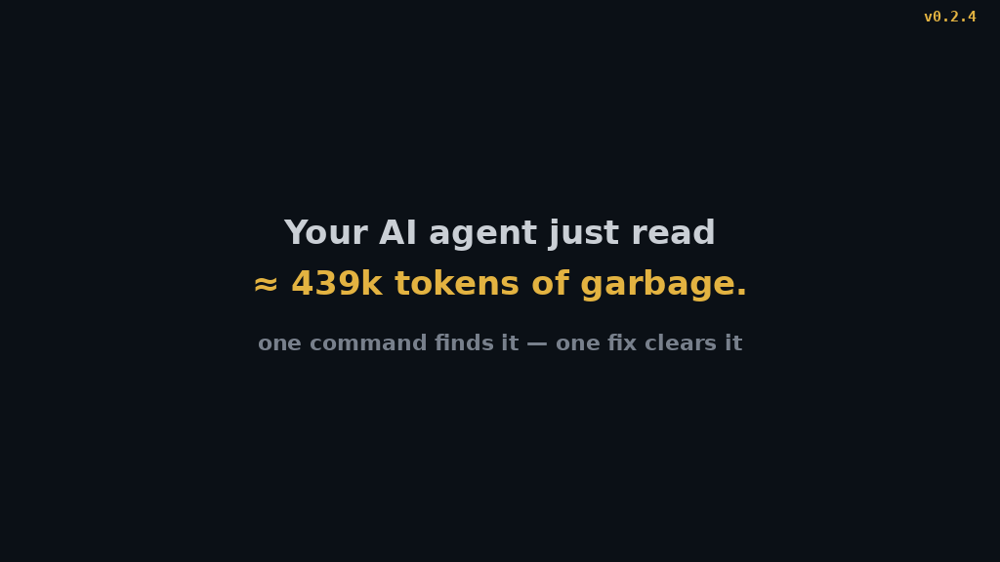

# dev-diagnosis

[](https://www.npmjs.com/package/dev-diagnosis-cli)
[](https://github.com/WJDdidi-1/dev-doctor/actions/workflows/ci.yml)
[](https://github.com/WJDdidi-1/dev-doctor/blob/main/LICENSE)
[](https://www.npmjs.com/package/dev-diagnosis-cli)

**One diagnosis for your repo, your commands, your cache and your tests.**

```sh
npx dev-diagnosis-cli all
```

One command. No install, no config. It tells you what your AI coding agent shouldn't be reading — and what that's costing you in tokens.

## It pays for itself in three lines

React ships 46 `yarn.lock` files, one per fixture directory — 6.4 MB your agent reads before it sees a line of source. We measured it:

```
$ npx dev-diagnosis-cli all        # in a React checkout
Score: 96/100 — ~2,141,395 tokens wasted every turn

$ npx dev-diagnosis-cli all --fix  # writes 3 lines to .aiignore
Score: 100/100 — 0 tokens wasted
```

Same story everywhere we looked: Node.js wastes ~24.8M tokens a turn on vendored deps, Next.js ~7.4M, Deno ~6.9M — mostly test fixtures and build output nobody reviews. ([Full measurements](https://github.com/WJDdidi-1/dev-doctor/blob/main/docs/measurements.md) of 10 famous repos.)

`all` also checks why a command isn't found (`path`), whether your build cache actually pays (`cache`), which tests are flaky (`flakes`), and the largest native binaries (`binaries`) — and it serves everything as an MCP server (`--mcp`) so your agent can call it directly. `--only <checks>` runs only the named checks and `--skip <checks>` runs all but the named ones (comma-separated: context, binaries, path, flakes, cache — the two cannot be combined): the cache check runs the build twice, so `all --skip cache` is the fast path when the build itself is not under suspicion, and skipped checks are listed as skipped so the summary stays honest.



## Try it: three steps, one fix

```sh
$ dev-diagnosis all
Files: 9  Size: 1.68 MB  Score: 75/100 — Some context noise found
Noise to keep away from an AI agent:
  data/export.json — large file (1.68 MB, ≈ 439k tokens)
Estimated tokens wasted on this noise: ≈ 439k tokens (estimate, ~4 bytes per token)
FAIL  some context noise found (score 75/100)

$ dev-diagnosis context --fix
Created .aiignore with 1 entry: data/export.json
Re-scanned after fix: Score: 94/100 — Looks clean for an AI coding agent
PASS  context is clean

$ dev-diagnosis all
Files: 9  Size: 1.16 KB  Score: 94/100 — Looks clean for an AI coding agent
PASS  context is clean
```

The noise cost 439k tokens a turn; the fix is one entry in `.aiignore`.

## When you reach for it

- Just took over a repo: `dev-diagnosis all`
- A repo vendors native binaries, or you are about to ship one: `dev-diagnosis binaries`
- CI goes red, then green on retry, then red again: `dev-diagnosis flakes ci-runs/`
- Builds feel slow even with a cache: `dev-diagnosis cache -- npm run build`
- `command not found` in the IDE but works in the terminal: `dev-diagnosis path <name>`

## What each check does — and does not do

| Check | Needs | Finds | Cannot find |
|---|---|---|---|
| `context` | a directory | files your agent should not read, and what they cost in tokens | whether a large file is actually needed — it flags by size, you decide |
| `binaries` | a directory | the largest native binaries and their hardening (PIE, NX, RELRO, stripped, entropy) | whether any of it is exploitable — it is a checkup, not an audit |
| `path` | a command name | which shell contexts resolve it, shadowed copies, toolchain installs | why a command that resolves still crashes when it runs |
| `cache` | a build command and a cache directory | whether the cache pays, cold vs warm | whether a different cache setup would be faster |
| `flakes` | JUnit XML from two or more runs | flaky, always-failing and passed-on-retry tests, ranked | why a test is flaky — only that it is |

## Install and run

```sh
npx dev-diagnosis-cli
```

Or install it once and use it anywhere:

```sh
npm install -g dev-diagnosis-cli
dev-diagnosis all
```

Rather not install it by hand? Paste this to your coding agent: "Install dev-diagnosis (npm install -g dev-diagnosis-cli if it's not on PATH), then run dev-diagnosis setup so you can use it."

`dev-diagnosis` with no arguments is the same as `dev-diagnosis all` on the current directory, and `dev-diagnosis <path>` is the same as `dev-diagnosis all <path>`. Each check is also available on its own:

```sh
dev-diagnosis context [path]                        # files an AI agent should not read
dev-diagnosis path <command>                        # why a CLI command is missing
dev-diagnosis cache -- <build-command...>           # cold vs warm timing for a build cache
dev-diagnosis flakes <junit-dir>                    # flaky tests from JUnit XML across runs
dev-diagnosis all [path] --command <name> --flakes <dir> -- <build-command...>
```

`all` always runs `context` on `[path]` (default: the current directory) and runs `path`, `flakes` and `cache` when their input is given. Checks without their input are listed as skipped, with the command that would run them, instead of silently pretending they ran. A build command on a repo with no cache directory to measure is also listed as skipped rather than failing: nothing to measure is not a problem. `--json` gives machine-readable output for `context`, `path`, `cache`, `flakes` and `all`. In `all --json`, a check that could not run (a missing runs directory, a failing build) reports `{ "error": "<reason>" }` instead of `null`, so a script can tell why the overall result failed. Add `--fix` to `context` (or `all`) to write the suggestions into `<path>/.aiignore` instead of only printing them: entries already there are left alone, nothing else in the file is touched, and a later scan skips everything `.aiignore` lists — so `context --fix` followed by `context` comes back clean. Add `--dry-run` with `--fix` to preview first: it lists the entries that would be added, diff-style, and writes nothing — and exits `1` when the fix would change `.aiignore`, even when the score passes (like `prettier --check`), `0` only when nothing would change and the repo passes.

`all` ends with a one-line summary: how many checks passed, failed or were skipped, how much context noise was found, and what the cache saved when it ran. In `--json` output the same fields are in the `summary` object. Add `--report <file>` to `all` to also write the run as a Markdown report — the same score, noise list with token costs, suggestions and verdicts, in prose you can paste to an agent or attach to a PR, instead of copying terminal output by hand. It works with `--json` (the JSON on stdout stays parseable) and with `--fix` (the report reflects the post-fix re-scan).

Exit codes: `0` every check that ran passed; `1` a check found something to fix or could not run; `2` usage error. With `--fix`, the exit code follows a re-scan after the fix, so a fix that leaves the repo clean exits `0` — the command reports the repo as it stands after the fix, not as it was before. With `--fix --dry-run` nothing is written, so the exit code is `1` when the fix would change `.aiignore` — even when the score passes — and `0` only when the fix would change nothing and every check passes.

Shell completion for bash, zsh and fish: `dev-diagnosis completion bash` prints a completion script generated from the same command list the CLI parses, so it can never suggest a flag the CLI rejects. Install it with, e.g. `dev-diagnosis completion bash > ~/.bash_completion.d/dev-diagnosis`, or `source <(dev-diagnosis completion bash)` for a one-off session. Mistyped a flag anyway? The CLI suggests the closest match (`Did you mean ...?`) instead of a bare error.

## Let your agent run it

### One-command install

`dev-diagnosis setup` detects the agents on your machine (Claude Code, Codex CLI, Cursor, Gemini CLI, VS Code) and writes the MCP config that wires dev-diagnosis into each of them. It prints a preview of exactly what will be written before writing anything: a config that already mentions dev-diagnosis is left alone, a config that exists without it is merged (other entries kept), a missing config is created. A config it cannot parse is left alone and reported.

```sh
dev-diagnosis setup            # preview, then write
dev-diagnosis setup --dry-run  # preview only, write nothing
dev-diagnosis setup --check    # report which agents are wired (exit 0 when all are)
dev-diagnosis setup --hooks    # install native git hooks instead (see Pre-commit hook)
```

`setup --hooks` installs the commit-time enforcement as native git hooks — no pre-commit, no husky: it writes `.githooks/pre-commit` and `.githooks/commit-msg` (the same two commands the Husky section documents) and sets `core.hooksPath` to `.githooks`. Commit `.githooks/` and every clone gets the hooks. It never overwrites a hook file or a hooks path it did not install, and `setup --hooks --check` reports whether they are installed.

If `dev-diagnosis` itself is not on PATH, setup says so — install it globally (`npm install -g dev-diagnosis-cli`) or the agents will not be able to run it.

### Is it working?

`dev-diagnosis doctor` checks the installation itself: Node version, `dev-diagnosis` and `git` on PATH, the home directory setup and `--skill-generate` write into, installed skills (and whether their frontmatter is valid — a broken one silently never triggers), MCP wiring and `.aiignore`. It is read-only — it changes nothing, so it works even when the rest of the tool is misbehaving — and every failure comes with a copy-paste fix. Warnings are for optional wiring (a missing skill, an unwired agent); only failures make it exit 1. `--json` gives the same checklist as data. The method is Claude Code's `claude doctor`: one command that answers "is my install healthy?" instead of debugging each piece by hand.

### MCP server

`dev-diagnosis --mcp` serves the checks as MCP tools over stdio — no extra install, no network, the same code the CLI runs. Add it to your agent once:

Claude Desktop: the repo ships a `manifest.json` (MCPB, the renamed DXT format) — pack it with `npx @anthropic-ai/mcpb pack` and drag the `.mcpb` file onto Settings → Extensions. The bundle is just the server (zero dependencies, so there are no node_modules to bundle), and `.mcpbignore` keeps tests, docs and tooling out of it.

Claude Code (`.mcp.json` in the repo, or `claude mcp add dev-diagnosis -- dev-diagnosis --mcp`):

```json
{
  "mcpServers": {
    "dev-diagnosis": {
      "command": "dev-diagnosis",
      "args": ["--mcp"]
    }
  }
}
```

Codex (`codex mcp add dev-diagnosis -- dev-diagnosis --mcp`, or in `~/.codex/config.toml`):

```toml
[mcp_servers.dev-diagnosis]
command = "dev-diagnosis"
args = ["--mcp"]
```

Gemini CLI (in `~/.gemini/settings.json`, under `mcpServers` — the same shape as Claude Code's):

```json
{
  "mcpServers": {
    "dev-diagnosis": {
      "command": "dev-diagnosis",
      "args": ["--mcp"]
    }
  }
}
```

To keep the agent inside one repo, add `--sandbox <dir>` (alias `--root`): paths outside it are rejected with a plain error. Add `--read-only` to serve only the read-only tools: `diagnose_cache` is not listed at all (it runs a build command), and `diagnose_context`, `diagnose_all` and `diagnose_secrets` lose their write inputs (`fix`, `buildCommand`, `writeSecretsBaseline`) and declare `readOnlyHint: true` — so a host that auto-approves read-only tools can call them without prompting, and a call that asks for a write anyway gets a tool error instead of a write. The method is GitHub's official MCP server's `--read-only` mode. Seven tools: `diagnose_context`, `diagnose_binaries`, `diagnose_path`, `diagnose_cache`, `diagnose_flakes`, `diagnose_all`, `diagnose_secrets` — each returns the same JSON the CLI's `--json` produces, as the text block and again as `structuredContent`, the MCP structured-output channel (each tool declares a loose `outputSchema: { type: 'object' }`; error results carry none), so a calling application can read the fields typed instead of parsing the text. `diagnose_binaries` checks up the largest native binaries in a repo (`path`, plus `top`) — the tool form of the `binaries` command. `diagnose_secrets` scans named files for secrets (`paths`, plus `secretsBaseline` / `writeSecretsBaseline`) — the tool form of the `secrets` command, for a commit message file or any file before sharing it. `diagnose_context` and `diagnose_all` take `fix: true` to write the `.aiignore` suggestions, and `fix: true, dryRun: true` to preview them instead — the result is the repo as it stands, with the plan in the `fix` object marked `dryRun: true`, and nothing is written. They also take `changedRef` to scope the scan to the files git lists as changed vs that ref (empty means `HEAD`), and `newFromRev` to report only noise that is new since a ref (empty means `HEAD`; implies `changedRef`). It also serves one prompt, `diagnose_repo` (`prompts/list` / `prompts/get`): the one-shot "diagnose this repo" workflow — call `diagnose_all`, report the score and noise, preview the `.aiignore` fix with `dryRun`, and ask before writing anything — for MCP clients that let the user pick a prompt instead of typing a request. The method is FastMCP's: prompts are the third MCP primitive, the user-invoked template next to tools and resources.

### Agent Skills

`dev-diagnosis --skill-generate` writes `.claude/skills/dev-diagnosis/SKILL.md` in the current repo (or `~/.claude/skills/dev-diagnosis/SKILL.md` with `--global`). With `--agents` it writes the same skill to `.agents/skills/` instead — the shared location Gemini CLI (108,873 stars) and Codex discover skills from — so the skill reaches them too. The skill tells an agent to run `dev-diagnosis all` when it starts work in a repo, fix what FAILs, and re-run to confirm. It refuses to overwrite an existing SKILL.md, so your own edits are safe. In the repo it also appends a short section to `AGENTS.md`, so agents that read AGENTS.md at startup find it too.

Claude Code users can install the skill without installing the CLI first: `/plugin marketplace add WJDdidi-1/dev-doctor`, then `/plugin install dev-diagnosis@dev-diagnosis`. The skill lives in this repo at `skills/dev-diagnosis/SKILL.md`, so skill indexes can find it too.

AI agents looking for this tool: [llms.txt](llms.txt) has a short machine-readable summary.

## In CI

One step runs the diagnosis and fails the job when a check fails:

```yaml
jobs:
  diagnose:
    runs-on: ubuntu-latest
    steps:
      - uses: actions/checkout@v4
      - uses: actions/setup-node@v4
        with:
          node-version: 20
      - uses: WJDdidi-1/dev-doctor@main
        with:
          path: .
          args: --command node
```

`args` is passed straight to `dev-diagnosis all`, so `--command`, `--flakes`, `--fix` and a build command after `--` all work the same way they do on the command line. The action runs the published npm package (`@latest`), so a repo using it always gets the newest checks.

`args: --annotations` also prints the top noise items as GitHub Actions workflow commands (`::warning file=...::...`), so they surface on the run's annotations panel without opening the log — no token, no file, no upload. A failing score adds one run-level `::error::`. At most 10 items, the platform's per-level cap. With `--json` the lines go to stderr so stdout stays parseable. The method is golangci-lint's github-actions output format.

The same `all` report also lands in the run's Step Summary when the step runs inside GitHub Actions — no flag needed, the CLI appends the `--report` Markdown to the file `GITHUB_STEP_SUMMARY` points at, so the score, the noise list and the fix show on the run page without opening the log. Local runs are unaffected (the variable is unset outside Actions), a write failure only warns, and `--json` stdout stays parseable. The method is actions/toolkit's `core.summary` (GitHub's own ToolKit builder for the same file).

## Pre-commit hook

Catch the noise at commit time instead of after it is committed. This repo ships a `.pre-commit-hooks.yaml`, so with [pre-commit](https://pre-commit.com) installed, add this to your `.pre-commit-config.yaml`:

```yaml
- repo: https://github.com/WJDdidi-1/dev-doctor
  rev: v0.2.5
  hooks:
    - id: dev-diagnosis
    - id: dev-diagnosis-commit-msg
```

On every commit the hook runs `dev-diagnosis context --changed --staged` — it scores only the files staged for this commit and fails the commit when the staged change's score drops below 85, the same threshold as the `context` check. `--staged` (lint-staged's method: judge the staged set) means the verdict is exactly about what will be committed: an unstaged noisy file no longer blocks the commit, and an untracked file is judged once it is `git add`ed. It never writes anything: on failure it prints the noise and the fix, and you run `dev-diagnosis context --fix --changed --staged` and re-commit. The hook needs pre-commit and Node.js 18+. To also block a new secret at commit time, generate a baseline (`dev-diagnosis context --write-secrets-baseline .dev-diagnosis-secrets-baseline.json`, commit it) and add the flag to your own config's `args`: `args: [context, --changed, --staged, --secrets-baseline, .dev-diagnosis-secrets-baseline.json]` — the commit then fails only on a secret the baseline does not cover, never on one already triaged.

A second hook, `dev-diagnosis-commit-msg`, runs on the commit-msg stage: pre-commit passes it the commit message file, and it scans the message for secrets with `dev-diagnosis secrets` — the message is not a file in the tree, so the context hook can never see a key pasted into it (commitlint's `--edit $1` contract: the message arrives as a file path, after it exists). It fails the commit when the message contains a possible secret and never prints the value; a secret the baseline covers does not block it (pass `--secrets-baseline` in that hook's `args` too). The `secrets` command also scans any file on its own — a file before sharing it, a pasted config — with `--secrets-baseline` / `--write-secrets-baseline` working the same way as on `context`.

### Husky

The same two commands work under [husky](https://typicode.github.io/husky/) — the hook manager most JavaScript projects already use — with no pre-commit install: hooks are plain shell scripts in `.husky/`, and husky points git at them with `core.hooksPath` (husky's method: the hook is a file, not a config entry). Or skip husky entirely: `dev-diagnosis setup --hooks` writes the same two files into `.githooks/` and sets `core.hooksPath` itself. After `npm install -D husky` and `npx husky init`, add the two files:

```sh
# .husky/pre-commit
npx dev-diagnosis-cli context --changed --staged

# .husky/commit-msg
npx dev-diagnosis-cli secrets "$1"
```

The pre-commit hook judges exactly what will be committed (`--changed --staged`, the same command as the pre-commit hook above), and the commit-msg hook scans the message file git passes as `$1` for secrets. Install the CLI as a devDependency (`npm install -D dev-diagnosis-cli`) so `npx` resolves it locally instead of downloading it on every commit. The commands need dev-diagnosis-cli 0.2.4 or later (the `--staged` flag); the hook installed by `setup --hooks` runs the latest release, so it is covered from 0.2.5 on. Both hook paths were rehearsed end to end — clean first commit, staged noise blocked at 75/100, fix, re-commit, secret message blocked — with pre-commit 4.7.0 and husky 9.1.7.

## Example

The repo ships a small demo project in `examples/demo-repo` (a build output, a log, a lockfile and a 1.7 MB data dump) and two JUnit runs in `examples/runs`. `npm run example` runs `dev-diagnosis all` on it. This is its real output, copied verbatim (paths and cache timings vary by machine):

```
$ dev-diagnosis all examples/demo-repo --command node --flakes examples/runs -- node build.mjs
dev-diagnosis — /home/hatch/workspace/dev-doctor-build/dev-doctor/examples/demo-repo

== context ==
Repo: /home/hatch/workspace/dev-doctor-build/dev-doctor/examples/demo-repo
Files: 9  Size: 1.68 MB  Score: 75/100 — Some context noise found
  build output: 98 B (0%) — lost 0 of 40
  large files: 1.68 MB (99.9%) — lost 25 of 25
  lockfiles: 95 B (0%) — lost 0 of 20
  logs: 79 B (0%) — lost 0 of 15
Unknowns:
  - 1 file over 1 MB (1.68 MB) was not content-scanned for secrets — a credential inside one would not be found
Noise to keep away from an AI agent:
  data/export.json — large file (1.68 MB, ≈ 439k tokens)
Estimated tokens wasted on this noise: ≈ 439k tokens (estimate, ~4 bytes per token)
Worth a look before sharing:
  .env.example — environment template (usually safe to share)
Fix: add these to .aiignore (or the agent's ignore list):
  data/export.json
FAIL  some context noise found (score 75/100)

== binaries ==
No native binaries found (checked 1 file 16.0 KB or larger out of 8).
PASS  no native binaries found

== path ==
current      /usr/bin/node
login        /usr/bin/node
non-login    /usr/bin/node
daemon-like  /usr/bin/node
PASS  node resolves to /usr/bin/node

== flakes ==
runs: 2  tests: 5  flaky: 1  always-failing: 1
test                                           unstable  runs    trend  classification
com.example.LoginTest::rejectsExpiredToken          2/2     2  chronic  always-failing
com.example.CheckoutTest::appliesCoupon             1/2     2      new  passed-on-retry
FAIL  1 flaky, 1 always-failing across 2 runs

== cache ==
Cache dir: /home/hatch/workspace/dev-doctor-build/dev-doctor/examples/demo-repo/.cache
Command: node build.mjs
Cold: 484 ms  Warm: 82 ms  Saved: 402 ms (83%)
Verdict: cache pays — warm run is 402 ms (83%) faster than cold
PASS  cache pays: cold 484 ms, warm 82 ms (warm run is 402 ms (83%) faster than cold)

Overall: FAIL — see the checks above
Summary: 5 checks — 3 passed, 2 failed, 0 skipped; context noise 1.68 MB; cache saved 83%
```

The demo repo is intentionally noisy, so `all` exits 1: the context and flakes checks fail while path and cache pass. That is the point of the fixture.

## What each check does

### `context` — what an AI agent should not read

Walks the repo (skipping `.git`, `node_modules` and other hidden directories) and classifies every file: build output, large files over 1 MB, lockfiles, logs, binary payloads, secret-like files and environment templates. It prints a 0–100 score, the bytes lost per category, the noisy files, the files worth a look before sharing, and the `.aiignore` entries that would fix it. When the noise spans more than one top-level directory, it also prints the top directories by noise tokens, so you can see whether one directory is most of the job — the fix is usually one `.aiignore` pattern per directory, and a flat file list hides that (five 20k-token logs in `logs/` read as five small rows, but `logs/` as a group is 100k tokens). The rollup is the same list grouped, so the terminal, `--json` (`topDirectories`) and `--report` always agree; a single-directory scan prints no rollup, since it would just repeat the file list. Build-output directories are reported by their full path from the repo root (`packages/foo/dist/`, not a bare `dist/`) and rolled up into one row per directory, so the entry `--fix` writes matches nested build output too. A large file is fixed by its exact path from the repo root — no glob can single one file out — so `--fix` followed by a re-scan comes back clean even when the noise is a single oversized file. Files any `.aiignore` lists — the root one or one in a subdirectory, each applying to the directory it sits in (git's per-directory rule, so `pkg/.aiignore` hides `pkg/big.log` and nothing else) — are excluded from the scan entirely — they are what the agent will not be handed, so they are not noise any more. The scan also names `.aiignore` entries that match nothing in the repo (`unusedAiignore` in `--json`), so a dead entry — a file deleted long ago, a pattern that never matched — does not rot silently; it is advisory only, costs no score points, and `--fix` never removes entries. The method is ESLint's `--report-unused-disable-directives`. On a `--changed`-scoped scan the check is not made (`unusedAiignore` is `null`), because an entry matching an unchanged file would falsely read as unused. Files and directories listed in `.gitignore` — at the repo root or in a subdirectory — are excluded the same way: they are already invisible to most agents, so flagging them would be noise about noise, and `--fix` will not duplicate them into `.aiignore`. The common pattern forms work (`*`, `?`, `[...]`, `**`, `/`-anchored paths, directory-only `dir/`, and `!` negation with last-match-wins); `.git/info/exclude` and the global gitignore are not read. `context --fix` writes the suggestions into `.aiignore` for you; add `--dry-run` to preview the fix first — it lists the entries that would be added, diff-style, and writes nothing. `--json` includes the fix outcome in the output (with `dryRun: true` for a preview). `--changed` (or `--changed=<ref>`, default `HEAD`) scopes the scan to the files git lists as changed — tracked files that differ plus untracked files git does not ignore — so a repo with pre-existing noise can still answer whether your change added any: the score, the noise list and the totals are then the change's, not the repo's, and `--fix` with `--changed` only fixes the change. `--staged` with `--changed` narrows it further to the files staged in the index (`git diff --cached`), so a pre-commit check judges exactly what will be committed — an unstaged file never blocks it, and an untracked file is judged once it is staged. The method is lint-staged's: run against the files staged in Git. `--new-from-rev` (or `--new-from-rev=<ref>`, default `HEAD`) implies `--changed` and reports only noise that is new since the ref: a file that was already noisy at the ref counts only its growth, so touching a 2 MB lockfile to bump one version adds no noise, while growing it by 100 KB reports exactly those 100 KB — and the noise line shows the growth against the file's total size (`97.7 KB of 2.00 MB`), so the number is never mistaken for the file itself. A renamed file counts as new (its old path is not traced), and review items and secret findings are still reported for every changed file — a secret is a leak whenever it was added. The method is golangci-lint's `--new-from-rev`, at file level. It works on `all` too (the context section only; `path`, `flakes` and `cache` stay repo-wide), and the MCP `diagnose_context` / `diagnose_all` tools take the same scope as `changedRef` (plus `staged` and `newFromRev`). The method is bat's: a tool that reads files should know what changed. Review items — secret-like files and environment templates — are listed for a manual look and are never written by `--fix`: they cost no score points, so the entry would fix nothing, and a basename pattern such as `secret.js` would hide every same-named file in the repo, including test fixtures. They appear as `reviewSuggestions` in `--json`, printed as advisory. The scan also reads file contents for credential shapes (AWS keys, GitHub tokens, private keys, Slack tokens, and high-entropy values assigned to a key-like name), because a file the name check passes can still carry a live key inside it — the method is gitleaks': rules are data, each finding carries its rule id and line number. A finding is advisory review, costs no score points, and never prints the matched value; it is labelled unverified, because verifying a key would mean sending it to the issuing service and this tool is offline by design — the method is TruffleHog's verified/unverified split, minus the live check. Rotate a flagged credential; do not assume from the match alone that it is still live. The same credential in many files is reported once, with how many places it appears (`also in N more places` in the reason, `occurrences` in `--json`), so one test token snapshotted across a repo does not flood the review list — the triage decision follows the secret, not its address, which is also what the baseline matches on. A reference is not a value: an environment reference (`token = process.env.GH_TOKEN`), a GitHub Actions expression and a function call (`token = getToken(...)`) stay silent, the way a dotted property chain does — and so does a bare identifier in a code file (`token = previouslyFetchedTokenValue`), a variable, not a credential: a real credential in code is a string literal, while a bare value in an env file still flags (and a long all-hex value in code still flags too, since no real variable is 20 hex characters). Template files (`.env.example`), lockfiles, binary files and files over 1 MB are not content-scanned. A finding you have already triaged can go into a secrets baseline so it stops re-alerting: `dev-diagnosis context --write-secrets-baseline .dev-diagnosis-secrets-baseline.json` records the current findings (fingerprints only — the file never holds a value, so commit it), and `dev-diagnosis context --secrets-baseline <file>` suppresses the findings it covers and reports how many it suppressed. Once a baseline exists, a secret finding it does not cover fails the check even when the score passes; without one, findings stay advisory. The same scan is available on its own as `dev-diagnosis secrets <file>...` — for a commit message file, or any file before sharing it — with `--secrets-baseline` / `--write-secrets-baseline` working the same way. The method is detect-secrets': a baseline of hashed findings, audit, and fail-only-on-new. Re-scanning a large repo you already scanned is faster with `--cache`: the context check remembers each unchanged file (size + mtime) in `.dev-diagnosis-cache.json` at the scan root, so a second scan of an unchanged tree skips re-reading them — a 44-second scan of a 53,000-file repo comes back in about 5 seconds
  (measured on a Node.js checkout: 43.9 s fresh, 5.4–6.1 s cached — the
  walk, ignore matching and aggregation still run, only the content
  reads are skipped, so the win is about 8×, not the 20–40× the design
  first predicted). A fully-cached run does not rewrite the cache file:
  when nothing changed, its bytes and mtime stay as they were. It is
  opt-in and off by default; `--cache-location <file>` moves the cache file. The cache file is plain JSON (fingerprints only — findings carry rule and line, never a value) and is excluded from the scan; add it to `.gitignore`, it is machine-local. A changed `.aiignore` or `.gitignore`, a new tool version or a corrupt cache means a full re-scan, and a `--changed` scan only adds or updates entries for the files it saw, never drops the rest. The result says when the cache was used (`cached` in `--json`, one `Cache:` line in the terminal and `--report`) and a cache hit is a fingerprint-verified earlier observation, not a blind spot — cached files are never listed under `unknowns`. The cache is a local performance artifact, not a security boundary: a hand-edited cache file could hide a finding, the same as a hand-edited `.eslintcache` — delete the file to force a fresh scan. CI and the pre-commit hook never use it by default. The method is ESLint's `--cache`, metadata strategy only — hashing would cost the reads the cache exists to avoid.

The score is the *noise-only* part of ai-context-doctor's score: 100 minus the category-weighted share of noise bytes (build 40, large 25, lockfile 20, log 15). The full ai-context-doctor score also weighs context volume, one file dominating, file sprawl and binary payloads, so its composite number reads lower on the same repo. The file classification itself is the same. The check passes at 85 by default; `--min-score N` (context and all, a whole number from 0 to 100) moves the bar — a strict team passes at 95, an old repo starts at 70 and raises the bar as it cleans up — and the verdict, the exit code, the annotations and the report all follow the bar, which the result carries as `minScore`, so a 90/100 repo failing a 95 bar says so instead of printing a clean status next to a FAIL. The method is Biome's `--max-diagnostics` (with `--error-on-warnings`): the threshold is a number the user sets, not a constant baked into the verdict. Only noise in a category that actually lost points is listed as noise or suggested as a fix: a 95 B lockfile in a 1.7 MB repo loses 0 points, so it is not something to fix — a 100/100 scan lists nothing to fix.

The scan also reports what it does not know, in `--json` as `unknowns` (with `visibleFilesPct`, the share of the repo's files the score is based on) and on the terminal as an `Unknowns:` list: files past the file limit that were never counted, paths that could not be read (named, first five, then "… and N more"), symlinks to directories the scan deliberately did not follow, dangling symlinks whose target does not exist (named as broken links, not as files that could not be read), and files over 1 MB that were not content-scanned for secrets. An unknown costs no score points — it is a measured blind spot, not a failure — but a 100/100 on a half-scanned repo is not a clean bill for the whole repo, so the report says how much it saw. The method is REA's: every conclusion carries its evidence and its limits, and unknown is a first-class answer, not a missing one.

### `binaries` — what the native binaries in a repo look like inside

Scans the repo for native binaries (ELF, PE, Mach-O) 16 KB or larger — `.git`, `node_modules` and hidden directories are skipped, like the context scan — and reports the largest five (or `--top N`, at most 20) with one hardening table each: PIE, NX, RELRO, stripped, stack protector, fortify, CET/BTI-PAC, RPATH, RUNPATH, plus whole-file entropy. The headers are read with the Node standard library only: no engine, no network, no REA dependency. A value the headers cannot determine is reported as `unknown` with a note saying why — a static binary has no dynamic symbol table, so its stack protector cannot be told from headers — never guessed. High entropy (over 7.2) is noted as often packed or encrypted, not scored. This is a checkup, not a security audit: it reports what the headers say and never assesses exploitability, and it always passes — a binary with PIE disabled is a fact to know about before shipping it, not a failure of the repo. In `--json` the table is the `binaries` array (`totalBinaries` counts all found, `checkedFiles` counts the files whose magic bytes were read); `all` runs it with the default top five, and the MCP `diagnose_binaries` tool is the same check.

### `path` — why a command is missing

Runs the lookup in four shell contexts — current, login, non-login and daemon-like (a minimal `PATH`) — and reports one row per context, plus shadowed copies (other copies of the same command that lose to the winner) and toolchain installs (npm, cargo, bun, volta, go, pip, brew). Two PATH entries that point at the same file, for example `/bin/node` and `/usr/bin/node` where `/bin` is a symlink to `/usr/bin`, count as one copy, not a shadow. The fix is copy-pasteable: the install command for the detected toolchain, or the `export PATH=…` line for a command that exists but is not on `PATH`.

### `cache` — does the cache pay

Runs the build command twice: cold, with the cache directory moved aside, and warm, with it present, then reports both timings and the saving. The original cache is restored to its original state afterwards, and anything the cold run produced is thrown away. A cache directory that is the project root, contains it, or lies outside it is refused rather than moved. No network is involved; the check only runs your own build command. One timing sample is noise — a jittery build flips the verdict between repeats — so `cache --runs 3` (or `--runs 5`) times the build that many times cold and warm, judges the verdict on the medians, and shows the min–max spread next to them; the cap is 10, so nobody accidentally schedules an hour of builds. The method is hyperfine's: several timed runs and a median, not one sample. `--json` reports the timings and the verdict without the build's stdout, so a chatty build does not bloat the machine-readable output — in `all --json` the embedded cache check is the same shape; with `--runs` it also carries the `runs`, `coldRuns` and `warmRuns` arrays.

### `flakes` — which tests are flaky

Reads JUnit XML across CI runs — each subdirectory of `<junit-dir>` is one run, and each `*.xml` file directly under it is a run of its own — and ranks tests by instability, using a Wilson 95% lower bound so a test that failed twice in two runs outranks one that failed twice in twenty. It distinguishes *passed-on-retry* (failed then passed in the same run, the classic flake signature) from *always-failing* and plain cross-run flakes, and labels each test `new`, `chronic` or `recovered` from its history. CRLF line endings are normalised before parsing, so Windows-produced XML parses the same as Unix-produced XML. A file that cannot be parsed — broken XML, or a file with no root element at all (empty, whitespace-only, a lone declaration) — is printed as a warning and fails the check, so the verdict is never based on half-read data; a genuinely empty report (`<testsuites></testsuites>`) still counts as zero tests. `--top N` limits the listing to the N highest-ranked flaky tests, in the text table and in `--json` output alike; the totals still describe the whole run set. A run directory that contains no JUnit XML files at all is named and skipped, and also fails the check — a CI run that produced no reports is a broken upload, not a run with zero tests, and the report must not pretend it never existed. `--json` lists such runs under `skippedRuns`.

## Development

```sh
npm test            # node:test, no extra dependencies, run serially
npm run example     # run the CLI against the demo fixture
npm run demo:check  # verify the README demo tape against live CLI output
npm run demo        # re-render the README demo GIF from the tape (needs python3 + ffmpeg)
node scripts/bump-version.mjs <version>  # bump every version pin at once (see below)
```

The suite runs serially on purpose (`--test-concurrency=1`): the cache check times real builds, so test files running in parallel would skew its cold-vs-warm timings.

Coverage uses Node's built-in runner (Node 22+ only — the suite itself runs on Node 18+): `node --test --test-concurrency=1 --experimental-test-coverage --test-coverage-include='lib/**/*.mjs' --test-coverage-include='bin/*.js'`. The method is vitest's `--coverage`: measure first, then test the gaps the measurement shows, and leave the Windows-only and defensive paths uncovered on purpose rather than chasing the number.

The README screencast (`docs/demo.gif`) is rendered from `docs/demo.tape`, never hand-edited: the tape runs the real commands against the live CLI and pins the lines the GIF shows, so `npm test` fails as soon as the output format drifts, until the tape is updated and the GIF re-rendered with `npm run demo`. The method is VHS's: the demo is code.

Releases bump the version with `node scripts/bump-version.mjs <version>`: it moves every version pin at once — package.json, package-lock.json, server.json, the marketplace metadata, the pre-commit manifest, the README rev and the demo tape label — renames the CHANGELOG's `## Unreleased` heading, and refuses a drifted tree before writing anything. Re-render the demo GIF afterwards (`npm run demo`), since the tape label changed. The method is semantic-release's (one mechanical writer of version strings), without adopting semantic-release itself.

There is nothing to install: the CLI has no runtime dependencies, so
`npm test` works straight after cloning. Run the checkout as
`node bin/dev-diagnosis.js …` — see Troubleshooting if you reach for
`npx` inside the checkout. The checkout ships a `.aiignore` that
excludes the demo fixture (`examples/demo-repo/`), so `dev-diagnosis
all` on the repo itself passes its own `context` check — the fixture
is intentionally noisy test data, and it stays noisy when scanned
directly (`npm run example`).

Requires Node.js 18 or later. CI runs the tests and the demo on Node 18, 20, 22 and 24 across Ubuntu, macOS and Windows, and smoke-tests the packed tarball by installing it in a clean directory. Windows is covered by CI only — the Windows-only code paths (the `cmd.exe` retry for `.cmd`/`.bat` shims, `PATHEXT` lookup) have not been run on a real Windows machine.

## Troubleshooting

**`npx dev-diagnosis-cli` inside a checkout of this repo fails with
`dev-diagnosis: not found`.** npx sees the checkout's own `package.json`
— same name, same version — and tries to run the local bin, which only
exists once the bin is linked. `npm install` does not link it: with no
dependencies to install, npm creates no `node_modules` at all. Run the
checkout directly instead — `node bin/dev-diagnosis.js …` — or `npm link`
to get a `dev-diagnosis` command, or run `npx` from any other directory.

## Credits

dev-diagnosis merges four tools by the same author, each of which keeps working on its own:

- [ai-context-doctor](https://github.com/WJDdidi-1/ai-context-doctor) — the context classification, the category weights and the score; the `.aiignore` fix.
- [cli-path-doctor](https://github.com/WJDdidi-1/cli-path-doctor) — the four shell contexts, `PATHEXT` lookup, shadowed copies and the toolchain search.
- [cache-verdict](https://github.com/WJDdidi-1/cache-verdict) — cold vs warm timing and the stash-and-restore safety rules.
- [flake-ledger](https://github.com/WJDdidi-1/flake-ledger) — the JUnit parsing, passed-on-retry detection and the Wilson lower-bound ranking.

The XML parser, the command runner and the report format were rewritten for the unified CLI; the rest is ported logic, adapted to a shared output format. See `CHANGELOG.md` for what changed per release.

## License

Apache-2.0. See [LICENSE](LICENSE).
