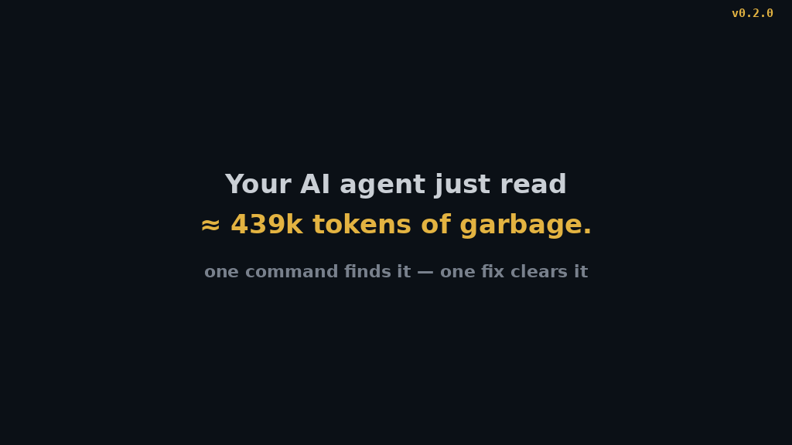

# dev-diagnosis

[](https://www.npmjs.com/package/dev-diagnosis-cli)
[](https://github.com/WJDdidi-1/dev-doctor/actions/workflows/ci.yml)
[](https://github.com/WJDdidi-1/dev-doctor/blob/main/LICENSE)
[](https://www.npmjs.com/package/dev-diagnosis-cli)

**One diagnosis for your repo, your commands, your cache and your tests.**

```sh
npx dev-diagnosis-cli all
```

One command. No install, no config. It tells you what your AI coding agent shouldn't be reading — and what that's costing you in tokens.

## It pays for itself in three lines

React ships 46 `yarn.lock` files, one per fixture directory — 6.4 MB your agent reads before it sees a line of source. We measured it:

```
$ npx dev-diagnosis-cli all        # in a React checkout
Score: 96/100 — ~2,141,395 tokens wasted every turn

$ npx dev-diagnosis-cli all --fix  # writes 3 lines to .aiignore
Score: 100/100 — 0 tokens wasted
```

Same story everywhere we looked: Node.js wastes ~24.8M tokens a turn on vendored deps, Next.js ~7.4M, Deno ~6.9M — mostly test fixtures and build output nobody reviews. ([Full measurements](https://github.com/WJDdidi-1/dev-doctor/blob/main/docs/measurements.md) of 10 famous repos.)

`all` also checks why a command isn't found (`path`), whether your build cache actually pays (`cache`), and which tests are flaky (`flakes`) — and it serves everything as an MCP server (`--mcp`) so your agent can call it directly.



## Try it: three steps, one fix

```sh
$ dev-diagnosis all
Files: 9  Size: 1.68 MB  Score: 75/100 — Some context noise found
Noise to keep away from an AI agent:
  data/export.json — large file (1.68 MB, ≈ 439k tokens)
Estimated tokens wasted on this noise: ≈ 439k tokens (estimate, ~4 bytes per token)
FAIL  some context noise found (score 75/100)

$ dev-diagnosis context --fix
Created .aiignore with 1 entry: data/export.json
Re-scanned after fix: Score: 94/100 — Looks clean for an AI coding agent
PASS  context is clean

$ dev-diagnosis all
Files: 9  Size: 1.16 KB  Score: 94/100 — Looks clean for an AI coding agent
PASS  context is clean
```

The noise cost 439k tokens a turn; the fix is one entry in `.aiignore`.

## When you reach for it

- Just took over a repo: `dev-diagnosis all`
- CI goes red, then green on retry, then red again: `dev-diagnosis flakes ci-runs/`
- Builds feel slow even with a cache: `dev-diagnosis cache -- npm run build`
- `command not found` in the IDE but works in the terminal: `dev-diagnosis path <name>`

## What each check does — and does not do

| Check | Needs | Finds | Cannot find |
|---|---|---|---|
| `context` | a directory | files your agent should not read, and what they cost in tokens | whether a large file is actually needed — it flags by size, you decide |
| `path` | a command name | which shell contexts resolve it, shadowed copies, toolchain installs | why a command that resolves still crashes when it runs |
| `cache` | a build command and a cache directory | whether the cache pays, cold vs warm | whether a different cache setup would be faster |
| `flakes` | JUnit XML from two or more runs | flaky, always-failing and passed-on-retry tests, ranked | why a test is flaky — only that it is |

## Install and run

```sh
npx dev-diagnosis-cli
```

Or install it once and use it anywhere:

```sh
npm install -g dev-diagnosis-cli
dev-diagnosis all
```

Rather not install it by hand? Paste this to your coding agent: "Install dev-diagnosis (npm install -g dev-diagnosis-cli if it's not on PATH), then run dev-diagnosis setup so you can use it."

`dev-diagnosis` with no arguments is the same as `dev-diagnosis all` on the current directory, and `dev-diagnosis <path>` is the same as `dev-diagnosis all <path>`. Each check is also available on its own:

```sh
dev-diagnosis context [path]                        # files an AI agent should not read
dev-diagnosis path <command>                        # why a CLI command is missing
dev-diagnosis cache -- <build-command...>           # cold vs warm timing for a build cache
dev-diagnosis flakes <junit-dir>                    # flaky tests from JUnit XML across runs
dev-diagnosis all [path] --command <name> --flakes <dir> -- <build-command...>
```

`all` always runs `context` on `[path]` (default: the current directory) and runs `path`, `flakes` and `cache` when their input is given. Checks without their input are listed as skipped, with the command that would run them, instead of silently pretending they ran. A build command on a repo with no cache directory to measure is also listed as skipped rather than failing: nothing to measure is not a problem. `--json` gives machine-readable output for `context`, `path`, `cache`, `flakes` and `all`. In `all --json`, a check that could not run (a missing runs directory, a failing build) reports `{ "error": "<reason>" }` instead of `null`, so a script can tell why the overall result failed. Add `--fix` to `context` (or `all`) to write the suggestions into `<path>/.aiignore` instead of only printing them: entries already there are left alone, nothing else in the file is touched, and a later scan skips everything `.aiignore` lists — so `context --fix` followed by `context` comes back clean. Add `--dry-run` with `--fix` to preview first: it lists the entries that would be added, diff-style, and writes nothing — the exit code follows the repo as it stands.

`all` ends with a one-line summary: how many checks passed, failed or were skipped, how much context noise was found, and what the cache saved when it ran. In `--json` output the same fields are in the `summary` object. Add `--report <file>` to `all` to also write the run as a Markdown report — the same score, noise list with token costs, suggestions and verdicts, in prose you can paste to an agent or attach to a PR, instead of copying terminal output by hand. It works with `--json` (the JSON on stdout stays parseable) and with `--fix` (the report reflects the post-fix re-scan).

Exit codes: `0` every check that ran passed; `1` a check found something to fix or could not run; `2` usage error. With `--fix`, the exit code follows a re-scan after the fix, so a fix that leaves the repo clean exits `0` — the command reports the repo as it stands after the fix, not as it was before. With `--fix --dry-run` nothing is written, so the exit code follows the repo as it stands.

Shell completion for bash, zsh and fish: `dev-diagnosis completion bash` prints a completion script generated from the same command list the CLI parses, so it can never suggest a flag the CLI rejects. Install it with, e.g. `dev-diagnosis completion bash > ~/.bash_completion.d/dev-diagnosis`, or `source <(dev-diagnosis completion bash)` for a one-off session. Mistyped a flag anyway? The CLI suggests the closest match (`Did you mean ...?`) instead of a bare error.

## Let your agent run it

### One-command install

`dev-diagnosis setup` detects the agents on your machine (Claude Code, Codex CLI, Cursor, VS Code) and writes the MCP config that wires dev-diagnosis into each of them. It prints a preview of exactly what will be written before writing anything: a config that already mentions dev-diagnosis is left alone, a config that exists without it is merged (other entries kept), a missing config is created. A config it cannot parse is left alone and reported.

```sh
dev-diagnosis setup            # preview, then write
dev-diagnosis setup --dry-run  # preview only, write nothing
dev-diagnosis setup --check    # report which agents are wired (exit 0 when all are)
```

If `dev-diagnosis` itself is not on PATH, setup says so — install it globally (`npm install -g dev-diagnosis-cli`) or the agents will not be able to run it.

### Is it working?

`dev-diagnosis doctor` checks the installation itself: Node version, `dev-diagnosis` on PATH, the home directory setup and `--skill-generate` write into, installed skills (and whether their frontmatter is valid — a broken one silently never triggers), MCP wiring and `.aiignore`. It is read-only — it changes nothing, so it works even when the rest of the tool is misbehaving — and every failure comes with a copy-paste fix. Warnings are for optional wiring (a missing skill, an unwired agent); only failures make it exit 1. `--json` gives the same checklist as data. The method is Claude Code's `claude doctor`: one command that answers "is my install healthy?" instead of debugging each piece by hand.

### MCP server

`dev-diagnosis --mcp` serves the same four checks as MCP tools over stdio — no extra install, no network, the same code the CLI runs. Add it to your agent once:

Claude Code (`.mcp.json` in the repo, or `claude mcp add dev-diagnosis -- dev-diagnosis --mcp`):

```json
{
  "mcpServers": {
    "dev-diagnosis": {
      "command": "dev-diagnosis",
      "args": ["--mcp"]
    }
  }
}
```

Codex (`codex mcp add dev-diagnosis -- dev-diagnosis --mcp`, or in `~/.codex/config.toml`):

```toml
[mcp_servers.dev-diagnosis]
command = "dev-diagnosis"
args = ["--mcp"]
```

To keep the agent inside one repo, add `--sandbox <dir>` (alias `--root`): paths outside it are rejected with a plain error. Five tools: `diagnose_context`, `diagnose_path`, `diagnose_cache`, `diagnose_flakes`, `diagnose_all` — each returns the same JSON the CLI's `--json` produces. `diagnose_context` and `diagnose_all` take `fix: true` to write the `.aiignore` suggestions, and `fix: true, dryRun: true` to preview them instead — the result is the repo as it stands, with the plan in the `fix` object marked `dryRun: true`, and nothing is written. They also take `changedRef` to scope the scan to the files git lists as changed vs that ref (empty means `HEAD`). It also serves one prompt, `diagnose_repo` (`prompts/list` / `prompts/get`): the one-shot "diagnose this repo" workflow — call `diagnose_all`, report the score and noise, preview the `.aiignore` fix with `dryRun`, and ask before writing anything — for MCP clients that let the user pick a prompt instead of typing a request. The method is FastMCP's: prompts are the third MCP primitive, the user-invoked template next to tools and resources.

### Agent Skills

`dev-diagnosis --skill-generate` writes `.claude/skills/dev-diagnosis/SKILL.md` in the current repo (or `~/.claude/skills/dev-diagnosis/SKILL.md` with `--global`). The skill tells an agent to run `dev-diagnosis all` when it starts work in a repo, fix what FAILs, and re-run to confirm. It refuses to overwrite an existing SKILL.md, so your own edits are safe. In the repo it also appends a short section to `AGENTS.md`, so agents that read AGENTS.md at startup find it too.

Claude Code users can install the skill without installing the CLI first: `/plugin marketplace add WJDdidi-1/dev-doctor`, then `/plugin install dev-diagnosis@dev-diagnosis`. The skill lives in this repo at `skills/dev-diagnosis/SKILL.md`, so skill indexes can find it too.

AI agents looking for this tool: [llms.txt](llms.txt) has a short machine-readable summary.

## In CI

One step runs the diagnosis and fails the job when a check fails:

```yaml
jobs:
  diagnose:
    runs-on: ubuntu-latest
    steps:
      - uses: actions/checkout@v4
      - uses: actions/setup-node@v4
        with:
          node-version: 20
      - uses: WJDdidi-1/dev-doctor@main
        with:
          path: .
          args: --command node
```

`args` is passed straight to `dev-diagnosis all`, so `--command`, `--flakes`, `--fix` and a build command after `--` all work the same way they do on the command line. The action runs the published npm package (`@latest`), so a repo using it always gets the newest checks.

## Example

The repo ships a small demo project in `examples/demo-repo` (a build output, a log, a lockfile and a 1.7 MB data dump) and two JUnit runs in `examples/runs`. `npm run example` runs `dev-diagnosis all` on it. This is its real output, copied verbatim (paths and cache timings vary by machine):

```
$ dev-diagnosis all examples/demo-repo --command node --flakes examples/runs -- node build.mjs
dev-diagnosis — /home/hatch/workspace/dev-doctor-build/dev-doctor/examples/demo-repo

== context ==
Repo: /home/hatch/workspace/dev-doctor-build/dev-doctor/examples/demo-repo
Files: 9  Size: 1.68 MB  Score: 75/100 — Some context noise found
  build output: 98 B (0%) — lost 0 of 40
  large files: 1.68 MB (99.9%) — lost 25 of 25
  lockfiles: 95 B (0%) — lost 0 of 20
  logs: 79 B (0%) — lost 0 of 15
Noise to keep away from an AI agent:
  data/export.json — large file (1.68 MB, ≈ 439k tokens)
Estimated tokens wasted on this noise: ≈ 439k tokens (estimate, ~4 bytes per token)
Worth a look before sharing:
  .env.example — environment template (usually safe to share)
Fix: add these to .aiignore (or the agent's ignore list):
  data/export.json
FAIL  some context noise found (score 75/100)

== path ==
current      /usr/bin/node
login        /usr/bin/node
non-login    /usr/bin/node
daemon-like  /usr/bin/node
PASS  node resolves to /usr/bin/node

== flakes ==
runs: 2  tests: 5  flaky: 1  always-failing: 1
test                                           unstable  runs    trend  classification
com.example.LoginTest::rejectsExpiredToken          2/2     2  chronic  always-failing
com.example.CheckoutTest::appliesCoupon             1/2     2      new  passed-on-retry
FAIL  1 flaky, 1 always-failing across 2 runs

== cache ==
Cache dir: /home/hatch/workspace/dev-doctor-build/dev-doctor/examples/demo-repo/.cache
Command: node build.mjs
Cold: 484 ms  Warm: 82 ms  Saved: 402 ms (83%)
Verdict: cache pays — warm run is 402 ms (83%) faster than cold
PASS  cache pays: cold 484 ms, warm 82 ms (warm run is 402 ms (83%) faster than cold)

Overall: FAIL — see the checks above
Summary: 4 checks — 2 passed, 2 failed, 0 skipped; context noise 1.68 MB; cache saved 83%
```

The demo repo is intentionally noisy, so `all` exits 1: the context and flakes checks fail while path and cache pass. That is the point of the fixture.

## What each check does

### `context` — what an AI agent should not read

Walks the repo (skipping `.git`, `node_modules` and other hidden directories) and classifies every file: build output, large files over 1 MB, lockfiles, logs, binary payloads, secret-like files and environment templates. It prints a 0–100 score, the bytes lost per category, the noisy files, the files worth a look before sharing, and the `.aiignore` entries that would fix it. When the noise spans more than one top-level directory, it also prints the top directories by noise tokens, so you can see whether one directory is most of the job — the fix is usually one `.aiignore` pattern per directory, and a flat file list hides that (five 20k-token logs in `logs/` read as five small rows, but `logs/` as a group is 100k tokens). The rollup is the same list grouped, so the terminal, `--json` (`topDirectories`) and `--report` always agree; a single-directory scan prints no rollup, since it would just repeat the file list. Build-output directories are reported by their full path from the repo root (`packages/foo/dist/`, not a bare `dist/`) and rolled up into one row per directory, so the entry `--fix` writes matches nested build output too. A large file is fixed by its exact path from the repo root — no glob can single one file out — so `--fix` followed by a re-scan comes back clean even when the noise is a single oversized file. Files the repo's `.aiignore` already lists are excluded from the scan entirely — they are what the agent will not be handed, so they are not noise any more. Files and directories listed in `.gitignore` — at the repo root or in a subdirectory — are excluded the same way: they are already invisible to most agents, so flagging them would be noise about noise, and `--fix` will not duplicate them into `.aiignore`. The common pattern forms work (`*`, `?`, `[...]`, `**`, `/`-anchored paths, directory-only `dir/`, and `!` negation with last-match-wins); `.git/info/exclude` and the global gitignore are not read. `context --fix` writes the suggestions into `.aiignore` for you; add `--dry-run` to preview the fix first — it lists the entries that would be added, diff-style, and writes nothing. `--json` includes the fix outcome in the output (with `dryRun: true` for a preview). `--changed` (or `--changed=<ref>`, default `HEAD`) scopes the scan to the files git lists as changed — tracked files that differ plus untracked files git does not ignore — so a repo with pre-existing noise can still answer whether your change added any: the score, the noise list and the totals are then the change's, not the repo's, and `--fix` with `--changed` only fixes the change. It works on `all` too (the context section only; `path`, `flakes` and `cache` stay repo-wide), and the MCP `diagnose_context` / `diagnose_all` tools take the same scope as `changedRef`. The method is bat's: a tool that reads files should know what changed. Review items — secret-like files and environment templates — are listed for a manual look and are never written by `--fix`: they cost no score points, so the entry would fix nothing, and a basename pattern such as `secret.js` would hide every same-named file in the repo, including test fixtures. They appear as `reviewSuggestions` in `--json`, printed as advisory.

The score is the *noise-only* part of ai-context-doctor's score: 100 minus the category-weighted share of noise bytes (build 40, large 25, lockfile 20, log 15). The full ai-context-doctor score also weighs context volume, one file dominating, file sprawl and binary payloads, so its composite number reads lower on the same repo. The file classification itself is the same. Only noise in a category that actually lost points is listed as noise or suggested as a fix: a 95 B lockfile in a 1.7 MB repo loses 0 points, so it is not something to fix — a 100/100 scan lists nothing to fix.

### `path` — why a command is missing

Runs the lookup in four shell contexts — current, login, non-login and daemon-like (a minimal `PATH`) — and reports one row per context, plus shadowed copies (other copies of the same command that lose to the winner) and toolchain installs (npm, cargo, bun, volta, go, pip, brew). Two PATH entries that point at the same file, for example `/bin/node` and `/usr/bin/node` where `/bin` is a symlink to `/usr/bin`, count as one copy, not a shadow. The fix is copy-pasteable: the install command for the detected toolchain, or the `export PATH=…` line for a command that exists but is not on `PATH`.

### `cache` — does the cache pay

Runs the build command twice: cold, with the cache directory moved aside, and warm, with it present, then reports both timings and the saving. The original cache is restored to its original state afterwards, and anything the cold run produced is thrown away. A cache directory that is the project root, contains it, or lies outside it is refused rather than moved. No network is involved; the check only runs your own build command. One timing sample is noise — a jittery build flips the verdict between repeats — so `cache --runs 3` (or `--runs 5`) times the build that many times cold and warm, judges the verdict on the medians, and shows the min–max spread next to them; the cap is 10, so nobody accidentally schedules an hour of builds. The method is hyperfine's: several timed runs and a median, not one sample. `--json` reports the timings and the verdict without the build's stdout, so a chatty build does not bloat the machine-readable output — in `all --json` the embedded cache check is the same shape; with `--runs` it also carries the `runs`, `coldRuns` and `warmRuns` arrays.

### `flakes` — which tests are flaky

Reads JUnit XML across CI runs — each subdirectory of `<junit-dir>` is one run, and each `*.xml` file directly under it is a run of its own — and ranks tests by instability, using a Wilson 95% lower bound so a test that failed twice in two runs outranks one that failed twice in twenty. It distinguishes *passed-on-retry* (failed then passed in the same run, the classic flake signature) from *always-failing* and plain cross-run flakes, and labels each test `new`, `chronic` or `recovered` from its history. CRLF line endings are normalised before parsing, so Windows-produced XML parses the same as Unix-produced XML. A file that cannot be parsed — broken XML, or a file with no root element at all (empty, whitespace-only, a lone declaration) — is printed as a warning and fails the check, so the verdict is never based on half-read data; a genuinely empty report (`<testsuites></testsuites>`) still counts as zero tests. `--top N` limits the listing to the N highest-ranked flaky tests, in the text table and in `--json` output alike; the totals still describe the whole run set. A run directory that contains no JUnit XML files at all is named and skipped, and also fails the check — a CI run that produced no reports is a broken upload, not a run with zero tests, and the report must not pretend it never existed. `--json` lists such runs under `skippedRuns`.

## Development

```sh
npm test            # node:test, no extra dependencies — 222 tests, run serially
npm run example     # run the CLI against the demo fixture
npm run demo:check  # verify the README demo tape against live CLI output
npm run demo        # re-render the README demo GIF from the tape (needs python3 + ffmpeg)
```

The suite runs serially on purpose (`--test-concurrency=1`): the cache check times real builds, so test files running in parallel would skew its cold-vs-warm timings.

The README screencast (`docs/demo.gif`) is rendered from `docs/demo.tape`, never hand-edited: the tape runs the real commands against the live CLI and pins the lines the GIF shows, so `npm test` fails as soon as the output format drifts, until the tape is updated and the GIF re-rendered with `npm run demo`. The method is VHS's: the demo is code.

There is nothing to install: the CLI has no runtime dependencies, so
`npm test` works straight after cloning. Run the checkout as
`node bin/dev-diagnosis.js …` — see Troubleshooting if you reach for
`npx` inside the checkout. The checkout ships a `.aiignore` that
excludes the demo fixture (`examples/demo-repo/`), so `dev-diagnosis
all` on the repo itself passes its own `context` check — the fixture
is intentionally noisy test data, and it stays noisy when scanned
directly (`npm run example`).

Requires Node.js 18 or later. CI runs the tests and the demo on Node 18, 20, 22 and 24 across Ubuntu, macOS and Windows, and smoke-tests the packed tarball by installing it in a clean directory. Windows is covered by CI only — the Windows-only code paths (the `cmd.exe` retry for `.cmd`/`.bat` shims, `PATHEXT` lookup) have not been run on a real Windows machine.

## Troubleshooting

**`npx dev-diagnosis-cli` inside a checkout of this repo fails with
`dev-diagnosis: not found`.** npx sees the checkout's own `package.json`
— same name, same version — and tries to run the local bin, which only
exists once the bin is linked. `npm install` does not link it: with no
dependencies to install, npm creates no `node_modules` at all. Run the
checkout directly instead — `node bin/dev-diagnosis.js …` — or `npm link`
to get a `dev-diagnosis` command, or run `npx` from any other directory.

## Credits

dev-diagnosis merges four tools by the same author, each of which keeps working on its own:

- [ai-context-doctor](https://github.com/WJDdidi-1/ai-context-doctor) — the context classification, the category weights and the score; the `.aiignore` fix.
- [cli-path-doctor](https://github.com/WJDdidi-1/cli-path-doctor) — the four shell contexts, `PATHEXT` lookup, shadowed copies and the toolchain search.
- [cache-verdict](https://github.com/WJDdidi-1/cache-verdict) — cold vs warm timing and the stash-and-restore safety rules.
- [flake-ledger](https://github.com/WJDdidi-1/flake-ledger) — the JUnit parsing, passed-on-retry detection and the Wilson lower-bound ranking.

The XML parser, the command runner and the report format were rewritten for the unified CLI; the rest is ported logic, adapted to a shared output format. See `CHANGELOG.md` for what changed per release.

## License

Apache-2.0. See [LICENSE](LICENSE).
